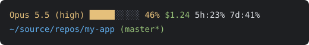

# claude-code-statusline

A fast, cross-platform [status line](https://code.claude.com/docs/en/statusline) for Claude Code, written in Rust. It's a single native binary for Windows, Linux (including WSL) and macOS, with no runtime to load. That matters because Claude Code cancels a status line run whenever a newer update arrives, so a slow script can leave the line blank.



```text
Opus 5.5 (high) █████░░░░░ 46% $1.24 5h:23% ↻2h14m 7d:41% ↻3d4h
~/source/repos/my-app (master*+ ↑2)
```

## What it shows

**First line**
- The model, with the effort level in parentheses.
- The output style, only when it isn't `default`.
- Context window usage as a 10-cell bar and a percentage: green up to 40%, amber above 40%, red above 90%.
- The session cost in USD, rounded to cents half away from zero on the amount Claude Code reports, so `0.145` shows as `$0.15`. Rounding the binary floating-point value instead, as most formatters do, would show `$0.14`.
- Claude.ai subscription rate limits for the 5-hour and 7-day windows, red above 90%, each followed by the time left until the window resets (`↻2h14m`, rounded up to the minute). The countdown only moves when Claude Code re-runs the status line, which it does on activity but not while the session sits idle. To keep it current while idle, add `"refreshInterval": 60` to the `statusLine` setting.

**Second line**
- The working directory, with your home folder shortened to `~`.
- The git branch, with `*` when tracked files have unstaged changes (or unresolved conflicts) and `+` when changes are staged, then `↑n` / `↓n` for commits ahead of and behind its upstream. A detached HEAD shows the short commit hash.

Any field Claude Code doesn't send is left out. `git` must be on `PATH`. If `git status` takes longer than 2 seconds (for example a network share, or a Windows drive under WSL's `/mnt/c`), the branch is left out for that run.

## Install

Download the archive for your platform from the [latest release](https://github.com/yuri-maxiutenko/claude-code-statusline/releases/latest):

| Platform | Archive |
|---|---|
| Windows x64 | `…-x86_64-pc-windows-msvc.zip` |
| Linux x64 / WSL (static, any distro) | `…-x86_64-unknown-linux-musl.tar.gz` |
| macOS Apple silicon | `…-aarch64-apple-darwin.tar.gz` |
| macOS Intel | `…-x86_64-apple-darwin.tar.gz` |

`SHA256SUMS.txt` in the release lists each archive's checksum.

Extract the binary somewhere stable, such as `~/.claude/bin/`. Then point Claude Code at it in `~/.claude/settings.json`:

```jsonc
// Windows: use forward slashes, since Claude Code may run the command through Git Bash
"statusLine": {
  "type": "command",
  "command": "C:/Users/<you>/.claude/bin/claude-code-statusline.exe"
}
```

```jsonc
// Linux, WSL, macOS
"statusLine": {
  "type": "command",
  "command": "~/.claude/bin/claude-code-statusline"
}
```

On macOS, a binary downloaded through a browser is quarantined. Clear the flag once with `xattr -d com.apple.quarantine ~/.claude/bin/claude-code-statusline`.

`claude-code-statusline --version` prints the release version.

## Build from source

```sh
cargo build --release   # target/release/claude-code-statusline(.exe)
cargo test
```

## Versioning

Releases use [Calendar Versioning](https://calver.org/): `YYYY.MM.DD`, the UTC release date, with a `.N` suffix for repeated releases on the same day.

## License

[MIT](LICENSE)
